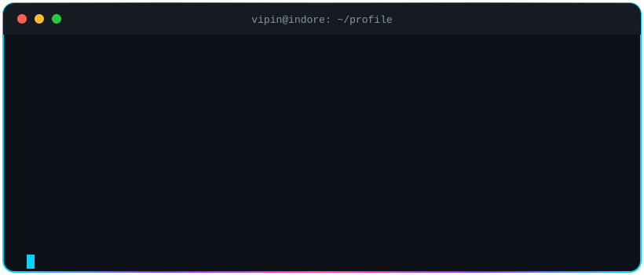

<!-- ═════════════════════════ HERO ═════════════════════════ -->
<div align="center">



<a href="https://github.com/vipinsaket">
  
</a>

<p>
  
  
  
  
</p>

<p>
  <a href="https://github.com/vipinsaket"></a>
  <a href="https://www.linkedin.com/in/vipinsaket/"></a>
  <a href="https://vipinsaket.github.io/Portfolio/"></a>
  <a href="https://leetcode.com/u/vipinsaket/"></a>
  <a href="mailto:vipinkumar11135@gmail.com"></a>
</p>



</div>

<div align="center"></div>

<!-- ═════════════════════════ ABOUT ═════════════════════════ -->
<div align="center"></div>

<table align="center">
<tr>
<td valign="top" width="52%">

I'm a **software developer from Indore, India** with a B.Tech in Computer Science and Engineering. I enjoy turning ideas into clean, maintainable applications. My main focus is **Java and backend development**, and I like building full-stack products that stay readable as they grow.

| | |
|---|---|
| ⚡ **Focus** | Java · OOP · Data Structures & Algorithms |
| 🧱 **Interested in** | Scalable applications and backend design |
| 🤖 **Exploring** | OpenAI API, AI chatbots, automation |
| 🏢 **Salesforce** | Apex, LWC, Flows, process automation |
| 🌐 **Web** | Responsive full-stack web apps |
| 🧩 **Practice** | Problem solving on [LeetCode](https://leetcode.com/u/vipinsaket/) |

</td>
<td valign="top" width="48%">

```java
public class VipinKumarSaket
        implements Developer {

  String location = "Indore, India";
  String[] focus = {
    "Java", "Backend",
    "Full-Stack", "AI", "Automation"
  };

  @Override
  public void code() {
    while (alive()) {
      learn();
      build();
      ship(); // readable & scalable
    }
  }
}
```

</td>
</tr>
</table>

<div align="center"></div>

<!-- ═════════════════════════ STACK ═════════════════════════ -->
<div align="center"></div>

<div align="center">

### ✅ Actively Using


<sub><b>Core CS:</b> Data Structures &amp; Algorithms · Object-Oriented Programming · Problem Solving</sub>

### 🌱 Learning & Exploring


</div>

<div align="center"></div>

<!-- ═════════════════════════ PROJECTS ═════════════════════════ -->
<div align="center"></div>

<div align="center">
  <a href="https://github.com/vipinsaket/Portfolio"></a>
  <a href="https://github.com/vipinsaket/LeetHub-2.0"></a>
  <a href="https://github.com/vipinsaket/CRUD_OperationsServlet"></a>
  <a href="https://github.com/vipinsaket/OpenAI_GPT"></a>
  <a href="https://github.com/vipinsaket/FolderPassword"></a>
  <a href="https://github.com/vipinsaket/E-Commerce.github.oo"></a>

  <sub>🌐 <a href="https://vipinsaket.github.io/Portfolio/">Live portfolio</a> · More repos: <a href="https://github.com/vipinsaket/ATM_System">ATM_System</a> (Java + MySQL) · <a href="https://github.com/vipinsaket/StringBasicProblem">StringBasicProblem</a> · <a href="https://github.com/vipinsaket/3D-Animated_webiste">3D-Animated_webiste</a></sub>
</div>

<div align="center"></div>

<!-- ═════════════════════════ STATS ═════════════════════════ -->
<div align="center"></div>

<div align="center">


<picture>
  <source media="(prefers-color-scheme: dark)" srcset="https://raw.githubusercontent.com/vipinsaket/vipinsaket/output/github-contribution-grid-snake-dark.svg" />
  <source media="(prefers-color-scheme: light)" srcset="https://raw.githubusercontent.com/vipinsaket/vipinsaket/output/github-contribution-grid-snake.svg" />
  
</picture>

</div>

<div align="center"></div>

<!-- ═════════════════════════ CONNECT ═════════════════════════ -->
<div align="center"></div>

<div align="center">

<a href="https://github.com/vipinsaket"></a>
<a href="https://www.linkedin.com/in/vipinsaket/"></a>
<a href="https://vipinsaket.github.io/Portfolio/"></a>
<a href="https://leetcode.com/u/vipinsaket/"></a>
<a href="mailto:vipinkumar11135@gmail.com"></a>

<br/><br/>


</div>
